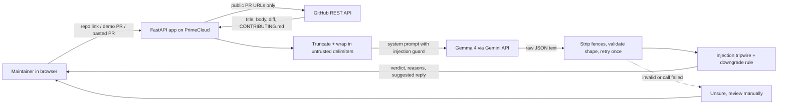

# PRTriage

**AI-assisted pull request triage for open-source maintainers. It recommends. The maintainer decides.**

- **Live URL:** TODO (add after PrimeCloud deployment, see [docs/PRIMECLOUD.md](docs/PRIMECLOUD.md))
- **Categories entered:** Gemma 4 · Open-Source AI · PrimeCloud
- **Model:** `gemma-4-26b-a4b-it` via the Gemini API (set in one line in [`backend/app/config.py`](app/config.py), shown in the app footer)

## Problem

Open-source maintainers are buried in pull requests. Many are low-effort or spam, some are good but missing a test,
and some try to manipulate whoever (or whatever) reviews them. Reading every one costs volunteer time that should go
to real contributions, and a rushed or unfair rejection discourages first-time contributors.

## Primary user

A volunteer maintainer of a small or mid-sized open-source project who gets more PRs than they can read carefully.

## Original contribution

Give PRTriage a **public GitHub repo link**. It lists the open pull requests as a queue on the left; click one and a
**review panel** on the right shows the verdict, the reasons and a reply to send. (You can also try the built-in demo PRs
or paste a PR by hand.) For each PR, PRTriage sends the title, description, diff and the repo's
`CONTRIBUTING.md` to **Gemma 4**, which returns:

1. a verdict: **Looks legit**, **Needs fixes**, **Low effort**, or **Unsure, review manually**
2. short, evidence-based reasons and concerns taken from the diff, description and `CONTRIBUTING.md`
3. a polite suggested reply the maintainer can post (written by Gemma)

What makes it different from a generic "summarize this PR" tool:

- **It checks the PR against that project's own rules** (`CONTRIBUTING.md`), not generic taste.
- **Prompt-injection defence.** PR text is untrusted. It is wrapped in delimiters, the system prompt tells Gemma to
  treat it as data, and a code-side tripwire makes sure a PR that tries to manipulate the reviewer can never end up as
  "Looks legit".
- **Fair to newcomers.** Account age is shown as weak context only. It is never sent to Gemma and never decides a verdict.
- **Honest about uncertainty.** If Gemma fails, returns unusable output, or the PR is ambiguous, the app says
  "Unsure, review manually" rather than guessing.

## How to use it

1. Open the app and paste a public repo link (for example your own test repo), then press **Load PRs**. No repo handy? Press **Try demo PRs**.
2. Click a pull request, or press **Triage all**. Gemma reads the description, the diff and the repo's `CONTRIBUTING.md`.
3. Read the side panel: the verdict (Looks legit, Needs fixes, Low effort, Unsure), why, what to watch out for, and a reply you can copy.
4. You decide. The tool never merges, closes or comments on anything.

## Architecture



| File | Role |
|---|---|
| `backend/app/config.py` | All settings. **The Gemma 4 model ID is set on one line here.** |
| `backend/app/prompts.py` | System prompt (with injection guard) and untrusted-data wrapping |
| `backend/app/gemma.py` | Gemini API call, JSON extraction and validation, one retry |
| `backend/app/triage.py` | Pipeline: truncate, prompt, judge, tripwire, safe fallback to "unsure" |
| `backend/app/github_client.py` | Fetches a public PR, its diff and `CONTRIBUTING.md` |
| `backend/app/main.py` | FastAPI routes and the web UI (`backend/app/static/index.html`) |
| `backend/app/ratelimit.py` | Per-client rate limit on the triage endpoints (`RATE_LIMIT_PER_MINUTE`, default 30) |
| `backend/scripts/create_test_repo.py` | Builds a real GitHub test repo with open PRs from the samples |
| `backend/samples/prs.json` | 8 synthetic PRs written by the team |

## Gemma 4 and licences

- **Exact model ID:** `gemma-4-26b-a4b-it` (alternative from the Starter Kit: `gemma-4-31b-it`). A Gemini model is not used for judging.
- **Model licence:** Apache 2.0, separate from this project's code licence. Link: https://www.apache.org/licenses/LICENSE-2.0 (TODO: replace with the official Gemma 4 model card / licence page from the Starter Kit)
- **Gemini API terms:** https://ai.google.dev/gemini-api/terms
- **This project's code licence:** MIT, see [LICENSE](LICENSE).

## Data permissions

The hosted terms say not to send personal or sensitive data to unpaid services. Therefore:

- All demo and test data is **synthetic**: 8 PRs written by the team for a fictional library (`backend/samples/prs.json`).
- No real contributor's name, username or private repo is used in the demo, README or slides.
- The GitHub URL mode reads **public** PRs only and is for the maintainer's own use. Do not point it at private code.

## Dependencies

Python 3.11+, `fastapi`, `uvicorn`, `httpx`, `google-genai`, `python-dotenv`, `pydantic` (see `requirements.txt`). Dev: `pytest`.

## Setup

```bash
git clone https://github.com/NjeriCodeCraft/prtriage.git && cd prtriage
cd backend
python3.11 -m venv .venv && source .venv/bin/activate
pip install -r requirements-dev.txt
cp .env.example .env        # then put your GEMINI_API_KEY in .env
uvicorn app.main:app --reload
# open http://localhost:8000
```

Docker (from `backend/`): `docker build -t prtriage . && docker run -p 8000:8000 --env-file .env prtriage`

## Tests

```bash
pytest -v                    # unit tests, fake model, no key needed
python scripts/create_test_repo.py --dry-run   # optional: builds the demo PR repo locally; drop --dry-run to create it on GitHub
python scripts/run_eval.py   # REAL Gemma run on the 8 samples, writes docs/TEST_RESULTS.md (needs GEMINI_API_KEY)
```

- **Unit tests** (fake model) check our own logic: JSON parsing and validation, truncation, the injection tripwire,
  failure handling, and the API. **Last run: 48 passed** (Python 3.13). Not yet run on Python 3.11 locally; the Dockerfile targets 3.11.
- **Live Gemma results** for the three cases judges ask about (normal, edge, failure/uncertainty) plus prompt injection
  are in [docs/TEST_RESULTS.md](docs/TEST_RESULTS.md). **Status: not run yet.** Nothing is claimed as passed until it is.

## Limitations

- It is a triage aid, not a code reviewer. It does not run the code or the project's tests.
- Long diffs are truncated (default 12,000 characters); the app tells the user when that happens.
- Gemma can be wrong. Treat verdicts as a recommendation and read the reasons.
- Prompt-injection defence reduces risk but is not a guarantee. The code-side tripwire only catches known phrasings.
- Repo mode uses the GitHub API. Without `GITHUB_TOKEN` the limit is 60 requests per hour and each PR costs about 3 to 5 requests, so set a token (read-only, no scopes) for anything beyond a few PRs.
- A PR that tries to steer the AI gets no suggested reply, by design.
- Triage endpoints are rate limited per client, in memory. It resets on restart and is not shared across several server copies.
- English-language PRs only were tested.

## AI Tools Used

Listed separately from Gemma, which is the product's model:

- TODO: confirm with your team. Built with help from Claude (Anthropic) as a coding assistant for scaffolding, tests and docs. Add any others (Copilot, Cursor, ChatGPT, etc.).

## Team contributions

- TODO: names and what each person did.

## Deployment on PrimeCloud

See [docs/PRIMECLOUD.md](docs/PRIMECLOUD.md). Live URL: TODO.

## Repository layout and hosting

```
backend/    FastAPI API (Python). Deploy on PrimeCloud with Root directory = backend (uses backend/Dockerfile)
frontend/   The web page (plain HTML/JS, no build step). Deploy on Vercel with Root Directory = frontend
docs/       Notes and test results
```

1. **Backend (PrimeCloud):** create the app from this repo with **Root directory `backend`**, set `GEMINI_API_KEY` and
   `GEMMA_MODEL_ID` as environment variables, health check `/healthz`.
2. **Frontend (Vercel):** import the repo, set **Root Directory** to `frontend`, no build command, no output directory.
3. Put the API's public address in `frontend/config.js` (`window.PRTRIAGE_API_BASE = "https://..."`, no trailing slash) and push.

CORS is open on the API, so the page on another address can call it. For local development run the API from `backend/`;
it also serves `../frontend` at `http://localhost:8000/`.

## Project files

[CONTRIBUTING.md](CONTRIBUTING.md), [SECURITY.md](SECURITY.md), a PR template and a CI workflow (`.github/`) are included.

## Licence

Code: MIT ([LICENSE](LICENSE)). Gemma 4 model: Apache 2.0 (see above).
